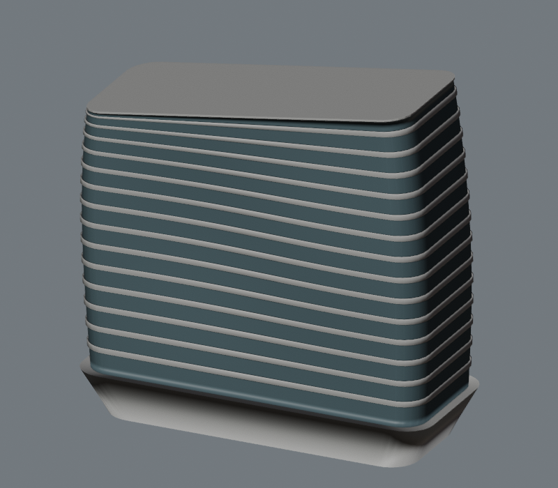

# 校園模型最後修改（2026-10-18）

已按建築師及理大實景照片重建 LKS、JCIT、Hotel ICON、Z 座的主要輪廓，並更新原網站使用的模型。這是低多邊形外觀模型；沒有取得測量圖、BIM 或現場量度，寬度、退台、平台標高和部分高度仍為近似值。

## 四棟修改

| 建築 | 本次修改 | 模型高度依據 |
|---|---|---|
| LKS 李嘉誠樓 | 直線方形樓體、較高的平頂翼、由柱承托的頂部圓筒；移除整座圓角玻璃塔的舊造型 | 約 60.8 m，保留視覺估值，並非測量高度 |
| JCIT 賽馬會創新樓 | 長形曲面樓體、連續白色樓層帶、高低斜冠、外展白色基座；移除圓頂與誇張傾斜 | 建築記錄 71.2 m；曲線及平面比例為照片近似 |
| Hotel ICON 唯港薈 | 有稜角的上部塔樓、教學低座、凹入的空中層、直向鋁片、低層會議裙樓；移除圓角塔及天線 | 建築記錄 114 m；不再用樓層數乘 3.2 m 推算 |
| Z 座 | 兩座高翼、低層教學翼、中庭及連橋；磚牆窗洞、直向柱帶，平台上的花槽及雨棚均有實際承托 | 高翼 48 m 為視覺估值；平台高度非實測 |

Hotel 與 University House 的地圖輪廓有交疊。University House 已保留在 Hotel 複合模型內，只裁去兩者相交的部分；背景不再重複生成同一建築。

## 其他穿模、懸空修整

屋頂物件改按樓板的實際三角面尋找承托位置。可放回的組件整組搬移，沒有合理承托面的裝飾整組省略。首輪重建記錄包含 93 組放回樓板、32 組省略（38 個物件）；後續另外修整 Block X 燈柱、GSH 雨棚柱及 Industrial Centre 重複頂點。

背景屋頂設備改檢查整個底面，並把底部放到屋頂高度；凹形、未重複首點的輪廓也會正確閉合。舊的包圍盒清理工具已改為使用同一套來源重建流程，避免重新生成時復發。

## 驗證

- 30 棟已匯出模型：座標有效、零退化三角面。
- 133 個具名屋頂物件：底面中心及頂點抽樣，未發現超出容許值的承托空隙或被主體完全埋入的情況。
- 334 個背景屋頂物件：整體底面輪廓和屋頂標高檢查通過。
- 四座主塔與鄰近地圖實體：20 m 高度、2 m 網格抽查未發現交疊；University House 與 Hotel 教學主體同樣通過獨立抽查。
- 網頁 JavaScript 語法、四棟搜尋／選取及模型載入已核對；LKS、Hotel、Z 的主體頂面與屋頂蓋面已分開，避免不同材質共面閃爍。

LKS、Hotel、Z 的重複窗戶、柱帶和鋁片已按材質合併，30 棟模型的繪圖網格總數由 3,964 減至 1154；合併前後三角面數及整體邊界一致（誤差低於 0.0001 m）。

這些檢查是指定物件與取樣位置的幾何檢查，不能視為所有細節完全無碰撞或與實體精確一致的認證。

數據：[模型檢查](final-qa.json)、[背景設備檢查](final-context-qa.json)、[相鄰建築檢查](final-adjacent-qa.json)。

## 最終輪廓預覽

| LKS | JCIT |
|---|---|
|  |  |

| Hotel ICON（含 University House） | Z 座 |
|---|---|
|  |  |

參照來源與適用範圍：[建築參考記錄](reference/README.md)。

## 重建

在專案目錄執行：

```sh
/Applications/Blender.app/Contents/MacOS/Blender --background --python-exit-code 1 --python tools/rebuild_all.py
python3 tools/audit_models.py
node tools/check_context.mjs
python3 tools/check_adjacent.py
/Applications/Blender.app/Contents/MacOS/Blender --background --python tools/render_fourviews.py
```

Blender 路徑依安裝位置調整；數值檢查需要 numpy。`rebuild_all.py` 包含全部 30 棟模型，JCIT 另可用一般 Python 生成 GLB。


Navigation follow-up: [FOLLOWUP-REVISION.md](FOLLOWUP-REVISION.md) — mobile layout, label collision, aliases, info card, JCIT sign.


Reference follow-up: [DATA-GAPS-20261019.md](DATA-GAPS-20261019.md) — additional LKS/JCIT/Hotel/Z material, Hotel three entrances, remaining survey gaps.
